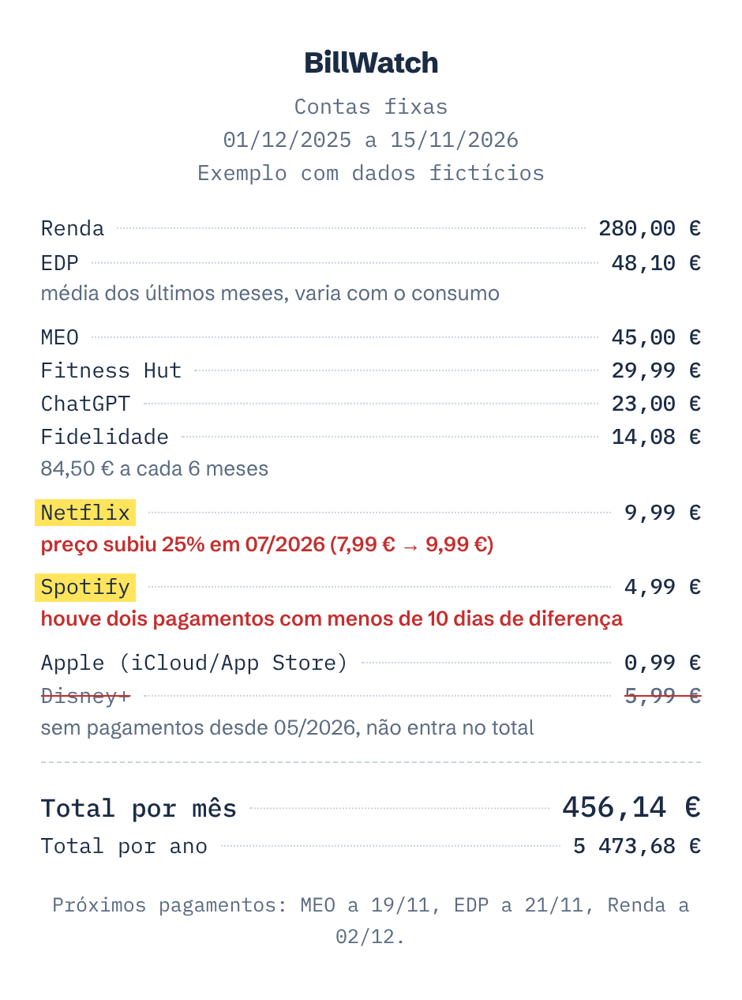

# 👀 BillWatch

**Descobre quanto pagas todos os meses e onde estás a pagar a mais.**

Carregas o extrato do banco e a app encontra sozinha as subscrições e contas fixas
(Netflix, ginásio, MEO, renda...), diz-te quanto isso dá por mês e por ano e avisa-te
quando um preço sobe, quando há uma cobrança duplicada ou quando um serviço parou de
ser cobrado. Também lê a fatura da luz em PDF e compara-a com outras ofertas.

Inspirado no Rocket Money (EUA), adaptado a bancos e serviços portugueses.
Feito em Python (pandas, pdfplumber) e Streamlit.

<p align="center"></p>

## Resultados

A deteção foi medida em **1000 extratos fictícios rotulados** (6 a 13 meses cada, 7301
subscrições). Os extratos têm de propósito os casos difíceis: abastecimentos na Galp,
MB WAY para amigos com valores redondos, compras de jogos ao mesmo preço, serviços
cobrados em dólares, subidas de preço, cancelamentos e cobranças duplicadas
(ver [Avaliação](#avaliação)).

| Métrica | Versão anterior | Atual |
|---|---|---|
| **Precisão** (quando diz que é subscrição, acerta) | 86,0% | **97,4%** |
| **Recall** (das subscrições que existem, quantas encontra) | 98,7% | **99,9%** |
| Erro médio no custo por mês | 0,23 € | **0,04 €** |
| Subidas de preço avisadas | 82,2% | **95,2%** |
| Avisos de subida falsos | 91 | **1** |
| Ativa / cancelada certa | 100% | 100% |

---

## Como correr

```bash
python -m venv .venv
source .venv/bin/activate          # Windows: .venv\Scripts\activate
pip install -r requirements-dev.txt
streamlit run app.py               # abre em http://localhost:8501
pytest                             # ~130 testes
python -m avaliacao.avaliar        # mede a qualidade da deteção
```

A app arranca com um **extrato de exemplo** (12 meses fictícios de um estudante), por
isso dá para experimentar logo sem dados reais. Os testes correm sozinhos no GitHub a
cada alteração (separador *Actions*).

## Formatos de extrato suportados

| Tipo | O que a app percebe |
|---|---|
| **CSV** | separador `;` `,` tab ou `\|` · codificação UTF-8 ou Windows · linhas de título antes da tabela · vários blocos no mesmo ficheiro (ex.: Revolut: resumo + conta + cripto) |
| **Excel** | `.xlsx`, `.xls` antigo e `.xls` que na verdade é HTML · datas reais ou em número série · títulos antes da tabela |
| **PDF** | com grelha ou só texto · colunas Débito/Crédito, "Dinheiro retirado/recebido", "Money out/in" ou um só "Montante" · do mais antigo para o mais recente ou ao contrário · várias secções e páginas · descrições em 2 linhas · data só na 1.ª linha de cada dia · PDFs com letras estragadas (`(cid:231)`) |
| **Valores** | `1.234,56` `1,234.56` `-9,99` `9,99-` `(9,99)` `+9,99` `9,99 D/C` `€9.99` `9,99 €` `1 234,56` · ou valor positivo com coluna D/C |
| **Datas** | `05-10-2026` `05/10/26` `05.10.2026` `2026-10-05` `5 out 2026` `5 de out. de 2026` `Oct 5, 2026` · e sem ano (`05.10`), com o ano tirado do período do extrato |
| **Limpeza** | movimentos revertidos/recusados saem · só a moeda principal (EUR) · linhas de saldo inicial/final e totais saem · ficheiros repetidos ou sobrepostos não duplicam |
| **Não é um extrato da conta** | extratos de cripto/investimentos (colunas Quantidade/Preço, tickers como BTC, ETH, SOL) são reconhecidos e ficam de fora, com uma explicação |

**Verificação de qualidade.** Cada leitura é verificada antes de entrar na análise: se a
maioria dos movimentos não tiver descrição, se as saídas forem mais de 10× as entradas
(ou o contrário) ou se houver muitos valores repetidos sem descrição, o ficheiro fica de
fora com um aviso a explicar porquê — em vez de aparecerem números absurdos. O
utilizador pode corrigir as colunas (CSV/Excel) ou decidir usá-lo mesmo assim.
No PDF, o leitor experimenta várias estratégias (tabelas desenhadas, colunas pelo
cabeçalho, só texto) e fica com a mais coerente: descrições preenchidas e saldo a bater certo.

**Se um formato não for reconhecido**, a app não fica presa: mostra a tabela e pede ao
utilizador que diga que coluna é a data, a descrição e o valor (já com um palpite
feito pelo conteúdo). Há também a opção *Inverter sinais*, e um **diagnóstico anónimo**
(letras → `x`, números → `9`) que se pode partilhar para corrigir o leitor sem expor dados.

Está tudo testado em `tests/formatos/`: 18 extratos fictícios que imitam formas reais de
exportar, todos gerados a partir dos mesmos movimentos — e o teste exige que todos deem
**exatamente** os mesmos movimentos, comerciantes e resultado final. Há ainda 3 ficheiros
"especiais" (cripto em PDF e CSV, e um PDF ilegível) que têm de ficar de fora com aviso.
Para acrescentar um formato novo: imitá-lo em `tests/gerar_formatos.py` e correr
`python tests/gerar_formatos.py`.

## Estrutura

```
app.py                  Configuração, estilo e navegação entre páginas
paginas/
  subscricoes.py        Carregar extratos e ver o talão das contas fixas
  luz.py                Ler a fatura da luz e comparar ofertas
  sobre.py              Como funciona, em linguagem simples
ui/
  estilo.py             Identidade visual (cores, CSS do talão)
  componentes.py        Peças visuais: talão, passos, gráfico, rodapé
  leitura.py            Ler os ficheiros carregados, com plano B se o formato for desconhecido
  dados.py              Leituras com cache
contas/                 A lógica, sem Streamlit (testável à parte)
  texto.py              Ler números e datas escritos de qualquer forma; anonimizar
  extrato.py            CSV/Excel/HTML → tabela → (data, descricao, valor); nome do comerciante
  leitor_pdf.py         Extratos em PDF (várias estratégias, fica a mais coerente)
  catalogo.py           Comerciantes conhecidos em PT → nome e categoria
  recorrentes.py        Deteção de pagamentos recorrentes + alertas
  energia.py            Fatura da luz e comparação de ofertas
  exemplo.py            Extrato fictício da demo e dos testes
avaliacao/              Medir a qualidade da deteção
  gerar.py              Extratos fictícios rotulados (cada movimento sabe se é subscrição)
  avaliar.py            Precisão, recall, erro no custo e alertas
static/                 Logótipo, favicon e fontes (servidos pela própria app)
.streamlit/config.toml  Tema: cores, fontes e tamanhos
dados/                  Ofertas de luz (VALORES DE EXEMPLO) e uma fatura fictícia
tests/                  Testes da lógica, dos formatos, da interface e da qualidade mínima
docs/                   Imagens do README
.github/workflows/      Corre os testes no GitHub a cada alteração
```

## Design

A ideia central é **o talão**: o resultado aparece como um talão de Multibanco, com cada
conta fixa numa linha e o total por mês no fundo. As cores só aparecem quando significam
alguma coisa:

| Cor | Significa |
|---|---|
| Papel `#EEF2F5` e tinta `#1B2B44` | a base: fundo e texto |
| Marcador `#FFE45C` | uma linha que merece atenção, como passar o marcador num extrato |
| Caneta vermelha `#C62D2D` | a nota que explica o alerta (preço subiu, cobrança repetida…) |
| Riscado a vermelho | um serviço que deixou de ser cobrado |

Tipos de letra: **Schibsted Grotesk** na interface e **IBM Plex Mono** só dentro do talão.
São servidos pela própria app (`static/fontes`, licença OFL), sem pedidos a terceiros.

## Como funciona

### 1. Ler o extrato (`extrato.py`, `leitor_pdf.py`, `texto.py`)
Cada banco exporta de forma diferente (ver a tabela acima). A leitura tem 3 passos:
1. **Ficheiro → linhas de células.** O separador do CSV escolhe-se pela consistência
   (o que dá o mesmo nº de colunas em mais linhas).
2. **Linhas → tabela.** Procuram-se *todas* as linhas que parecem cabeçalhos de
   movimentos (têm uma célula de data e uma de valor), lê-se o bloco depois de cada uma
   e juntam-se os blocos com as mesmas colunas. É assim que o resumo da Revolut fica de
   fora e os cabeçalhos repetidos em cada página de um PDF não estragam nada.
3. **Tabela → que coluna é qual**, pelo nome (cuidado: "Data Valor" é uma data!) e,
   se o nome não ajudar, pelo conteúdo (a coluna com mais datas válidas é a data).

**PDFs** não têm colunas — só palavras com coordenadas. O leitor agrupa as palavras em
linhas, encontra o cabeçalho e guarda a **posição horizontal** de cada coluna; cada
valor de um movimento pertence à coluna de cabeçalho mais próxima (débito, crédito ou
saldo). Depois **verifica pelo saldo**: saldo atual − saldo anterior = movimento com
sinal, testando as duas ordens possíveis (cronológica ou inversa). Se as colunas e o
saldo discordarem, o saldo ganha. Num PDF com uma só coluna de valores, se o banco
escreve "-" nas saídas e nunca "+", um valor sem sinal é uma entrada.

### 2. Dar nome ao comerciante (`catalogo.py` + `chave_comerciante()`)
A mesma subscrição aparece com descrições diferentes todos os meses:
`COMPRA 4521 NETFLIX.COM 866-579 12/03` e `COMPRA 8812 NETFLIX.COM 866-579 12/04`.
- Primeiro tenta o **catálogo** de comerciantes conhecidos. As palavras-chave contam
  como **palavras inteiras** e a mais comprida ganha: "HOMEOPATIA" não é MEO,
  "LOJA DAS PRENDAS" não é renda e "MEO ENERGIA" ganha a "MEO". Há também uma lista de
  nomes que *parecem* subscrições mas não são: abastecer na Galp ou na Repsol (a conta
  da luz vem como `GALP ENERGIA` ou por débito direto), `GOOGLE PLAY`, `GYMSHARK`...
- Numa **transferência para uma pessoa** (`MB WAY PARA ...`), palavras genéricas como
  SEGURO ou RENDA podem ser um apelido, por isso não contam.
- Se não estiver no catálogo, cria uma **chave**: tira acentos, pontuação, tudo o que
  tenha números (referências, datas, nº de cartão) e palavras de ruído bancário
  (COMPRA, DD, TRF, MB WAY, Cobrança SDD, Trf Imediata Sepa+...), e fica com as 2
  primeiras palavras.
- **Débitos diretos** (SDD) são quase sempre contas fixas, por isso precisam de menos
  provas, tal como os comerciantes do catálogo. **MB WAY para pessoas** precisa de mais
  um pagamento, porque valores redondos (10 €, 20 €) repetem-se por acaso.
- **Poupança e investimento** (cofres, cripto, PPR, corretoras) são recorrentes mas não
  são custos: aparecem à parte e não entram no "Pagas por mês".

### 3. Detetar recorrência (`recorrentes.py`)
Para cada comerciante:
1. Junta os pagamentos do mesmo dia e ordena por data.
2. Calcula os **intervalos em dias** entre pagamentos seguidos.
3. Compara a **mediana** dos intervalos com as periodicidades conhecidas
   (7, 30.4, 61, 91, 182, 365 dias, cada uma com uma tolerância).
4. Exige **regularidade**: ≥70% dos intervalos dentro da tolerância.
5. Exige **valor estável**: coeficiente de variação (desvio-padrão / mediana) ≤ 15%.
   Exceções: categorias de consumo (luz, água) podem variar, e uma subida de preço
   não elimina a subscrição (desde que seja uma subida, de no máximo +60%, e haja
   provas suficientes do preço antigo).
6. Comerciantes conhecidos precisam de 2 pagamentos; desconhecidos precisam de 3
   (menos provas para quem já sabemos que vende subscrições).

Porquê a **mediana** e não a média? Porque é robusta a outliers: um mês em que o
pagamento atrasou 10 dias não estraga a estimativa do intervalo.

### 4. Alertas
- **Subida de preço**: procura, do mais recente para trás, o ponto que divide os
  pagamentos em dois blocos estáveis com preços diferentes ("antes" e "depois") e
  compara as **medianas**. Assim o alerta diz *quando* subiu e não dispara por causa de
  um mês estranho. Serviços cobrados em dólares oscilam com o câmbio, por isso só há
  alerta se o preço não for fixo ao cêntimo e subir pelo menos 10%.
- **Possivelmente cancelada**: não houve pagamento há mais de 1,5× o intervalo normal.
  Estas não entram nos totais.
- **Cobrança duplicada**: num serviço mensal, dois pagamentos com menos de 10 dias.

### 5. Confiança
`0,5 × regularidade + 0,3 × estabilidade do valor + 0,2 × (está no catálogo)`.
É uma heurística simples e explicável, e um ponto de partida para um modelo treinado
com dados rotulados (ver [Próximos passos](#próximos-passos)).

### 6. Luz (`energia.py`)
`custo = termo fixo (€/dia) × dias + preço (€/kWh) × consumo (kWh)`, convertido para
um mês médio de 30,4 dias. Comparamos antes de IVA e taxas porque essas são
praticamente iguais em todas as comercializadoras e não mudam o ranking.
A leitura do PDF usa `pdfplumber` + expressões regulares. Cada comercializadora tem o
seu layout, por isso é "melhor esforço": a app mostra o que leu e deixa corrigir.

## Avaliação

`python -m avaliacao.avaliar --n 1000` gera 1000 extratos e compara o resultado da app
com a resposta certa. Cada extrato é de uma pessoa diferente: 4 a 11 subscrições
escolhidas de 32 tipos (streaming, telecomunicações, luz, água, ginásio, seguros, renda,
propinas, e 5 serviços **fora do catálogo** que só podem ser encontrados pelo padrão),
escritas como em bancos diferentes, com o dia de cobrança a variar e débitos que passam
para segunda-feira quando calham ao fim de semana. O ruído é o de um mês normal
(supermercado, cafés, Uber) e os casos que enganavam a versão anterior.

**Como se conta.** Cada linha do talão é comparada com os rótulos dos movimentos que a
formam: é um acerto se a maioria pertence a uma subscrição verdadeira. Precisão =
acertos / linhas mostradas; recall = acertos / subscrições verdadeiras.

**O erro que sobra** (quase todos os falsos positivos) é um corte de cabelo a preço fixo
de 4 em 4 ou de 5 em 5 semanas: tem exatamente o padrão de uma subscrição, mas não é
uma. Não foi "corrigido" com mais uma regra feita à medida dos dados de avaliação, o que
seria sobreajuste. É o tipo de caso que um modelo treinado com dados reais deve
resolver (ver abaixo).

O `tests/test_avaliacao.py` corre uma versão pequena (60 extratos) a cada alteração e
falha se a precisão descer de 95% ou o recall de 97%.

## Limitações

- **Os números acima vêm de dados sintéticos.** Medem se as regras fazem o que devem
  nos casos previstos; extratos reais vão ter casos que ninguém previu. O próximo passo
  é rotular extratos reais (ver abaixo).
- **As ofertas de luz são de exemplo** (comercializadoras fictícias), e a app avisa
  disso. A leitura da fatura e as contas são reais; para comparar com preços atuais
  pode carregar-se uma tabela própria.
- A leitura de faturas de luz é "melhor esforço": cada comercializadora tem o seu layout.

## Próximos passos

1. **Dados reais de ofertas de luz** com atualização mensal automática.
2. **Telecomunicações**: ler faturas da MEO/NOS/Vodafone/DIGI e comparar pacotes.
3. **Modelo de ML para a deteção**: recolher rótulos reais ("é / não é subscrição")
   de utilizadores voluntários e treinar um classificador (ex.: gradient boosting) com
   features como regularidade, variação do valor, nº de pagamentos, tipo de pagamento
   (cartão, débito direto, MB WAY), categoria e palavras da descrição. Comparar com a
   heurística atual usando a mesma avaliação.
4. **Alertas por email** quando aparece uma oferta mais barata (conta de utilizador).
5. **Ligação direta ao banco** via Open Banking (PSD2) em vez de CSV — exige parceiro
   licenciado; só vale a pena depois de validar que as pessoas usam.

## Licença

[MIT](LICENSE). Os tipos de letra têm a sua própria licença (OFL), em `static/fontes`.
